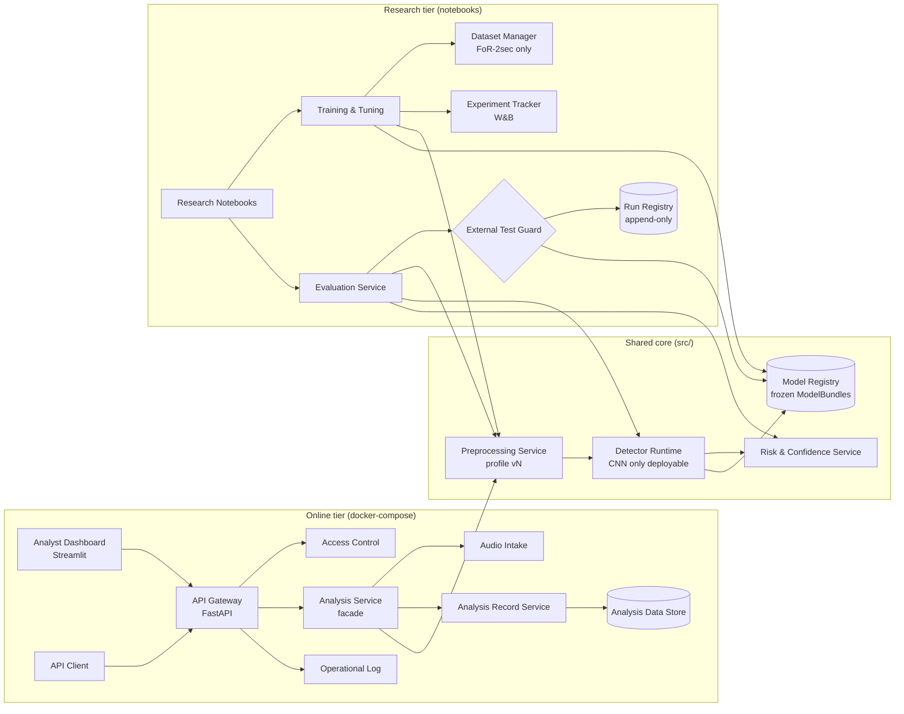

# Architecture

> Summary of the Lab 5 design: `docs/reference/SDD_Voice_Spoofing_Detection_Lab5.pdf` (SDD v1.0,
> September 2026). The SDD is the full reference; this page is the short version. Where the SDD and
> the decision register (`docs/decisions/README.md`) differ, the register wins (`AGENTS.md`,
> source-of-truth order). Keep this page in sync when the code drifts from the design.

## 1. Overview

The system has **two lifecycles around one shared core** (SDD §2.1):

- **Research tier** (Colab / Kaggle notebooks): dataset audit, training, model selection, risk-policy
  fit, evaluation, and the single guarded DEEP-VOICE run.
- **Online tier** (two containers, `api` + `dashboard`): analyzes one short recording per request
  and returns prediction (authentic / synthetic / uncertain), confidence and LOW/MEDIUM/HIGH risk
  level, with a decision-support notice.

Both tiers import the **same `src/` code**, so preprocessing, detector contract and risk policy
cannot drift between offline numbers and the deployed system (FR-04, NFR-09).

**Methodology:** object-oriented design. **Style:** layered (n-tier) architecture, pipeline stages
inside the Analysis Service, named interfaces at every layer boundary. Microservices and
event-driven styles were rejected: nothing in the SRS needs independent scaling or streaming.

## 2. Component diagram

The External Test Guard and the Experiment Tracker do not exist online: the deployed system can only
load a bundle that the research tier has already frozen.

## 3. Key modules

| Module | Responsibility | Lives in |
|---|---|---|
| Dataset audit | Stage 1 audit of FoR-2sec (full) and DEEP-VOICE (metadata only, D6/D20) | `src/audit/` |
| Preprocessing | Versioned profile: mono, 16 kHz (D18), silence handling, log-Mel / MFCC features | `src/preprocessing/` (Stage 6) |
| Models | `Detector` interface; CNN on log-Mel (deployable) and MFCC + RBF-SVM baseline (evaluation only, D7) | `src/models/` (Stages 7–9) |
| Risk | Applies the frozen policy (core): calibration, threshold at the val-B EER point, uncertain band, confidence, risk level (D2, D9, D12) | `src/risk/` (Stage 10) |
| Training & Tuning | Fits the risk policy on val-B (research tier) | `src/tuning/` (Stage 10) |
| Evaluation | One harness for baseline and CNN; required metric set (D4); external-run guard | `src/evaluation/` (Stage 7, 13) |
| API | FastAPI gateway, analysis facade, records, logs | `api/` (Stage 17) |
| Dashboard | Streamlit UI; calls the API only, no detector logic | `dashboard/` (Stage 18) |
| Configs | Dataset pins (D21) and run configs | `configs/*.yaml` |

## 4. Data model

The online system stores **metadata, never audio** (FR-09, NFR-04; SDD §4):

- `analysis_record`: request ID, time, model/config version, prediction, confidence, risk level,
  latency.
- `annotation`: analyst note stored beside, never inside, the original result (FR-11).
- `service_log`: version, volume, latency, outcome; no audio, no personal identifiers (FR-20).
- Temporary audio: removed on release or after `RETENTION_HOURS` (NFR-03).

Research artifacts are append-only files: the **ModelBundle manifest** (CNN checkpoint +
preprocessing profile + risk policy, one version tag, immutable once frozen; D2), the **run
registry** (at most one external run per dataset; PC-05), and **dataset manifests** in
`data/manifests/` (path, label, partition, group ID; PC-02).

## 5. Key flows

- **UC-01 Analyze audio (SDD Fig. 5):** dashboard → API Gateway → Analysis Service → intake
  validation → preprocessing → detector score → risk decision → record metadata → release audio →
  result. An invalid file returns a structured 4xx error with no inference and no record (NFR-06).
- **UC-08 External generalization test (SDD Fig. 6):** notebook → Evaluation Service → External
  Test Guard checks that the bundle is frozen and that no external run exists → score DEEP-VOICE with
  the same frozen pipeline → compute metrics → register the run, which blocks any second run
  (PC-04, PC-05; `AGENTS.md` hard rule 1).

## 6. The AI-assisted component

The detector is the AI component: a CNN on log-Mel spectrograms trained on FoR-2sec. Input: one
short recording. Output: a raw spoof score, turned by the frozen risk policy into exactly one of
authentic / synthetic / uncertain, a confidence in [0, 1] and a risk level. It is **decision
support, not proof of fraud**. If the bundle versions do not match, the Detector Runtime refuses to
start (NFR-09); if a request fails, no prediction is fabricated (NFR-06).

## 7. Known trade-offs / open questions

- Clips longer than 2 s: reject, truncate or window-and-aggregate (SDD §9.5). D5 fixes the
  evaluation unit (2 s windows); the online behavior is still open.
- Access-control mechanism (API key vs analyst login), SRS §7.4: open, decide before Stage 17.
- History persistence across restarts: SQLite volume first; open.
- Hosting vendor and TLS termination: open.
- Differences from the SDD set by later decisions: FoR validation split into val-A (training
  decisions) and val-B (risk policy, calibration) (D9); risk policy and calibration fitted before
  the freeze (D2); no robustness evaluation on DEEP-VOICE (D3).
