# Stage briefs

## Purpose

Execution Plan v2.1 §12: "Everyone should be able to explain the full pipeline end to end, not only
the part they built." A stage brief is a short (2–4 page) explanation of one stage, written by its
owner when the stage closes, so that every member, and the professor, can understand, explain and
re-run any stage without asking its author. Briefs link to the existing documents instead of
copying them. The rule is decision D32 (`docs/decisions/README.md`); the format is
[`TEMPLATE.md`](TEMPLATE.md).

## How briefs differ from the other documents

| Document | Answers | Audience |
|---|---|---|
| Stage brief (`docs/stages/`) | What does this stage do, why, how, what can we claim, how to check it? | Every member, the professor, the Stage 19 report |
| Project log (`docs/project_log.md`) | What happened, when, by whom, with which evidence? (append-only history) | The team and reviewers, following the work over time |
| Decision register (`docs/decisions/README.md`) | Which rule was decided, and is it approved? (D-IDs, hypotheses, ADRs) | Anyone checking whether a choice is allowed |
| Design notes (e.g. `docs/evaluation_harness.md`, `docs/model_bundle.md`) | How exactly is this component built: formats, methods, tests? | Developers who change or use the code |

## Process

1. **Write:** when a stage closes, its owner (D26) writes `docs/stages/stageNN-short-name.md` from
   the template. The brief is part of the stage's definition of done: it is in the closing PR or
   the next one.
2. **Teach-back review:** the reviewer (D26: the consumer reviews the producer) must be able to
   answer the brief's section 7 questions without asking the author. A question they cannot answer
   means the brief is not clear yet: the author revises it before approval.
3. **Weekly sync:** a member who did not write the stage explains it back in 5 minutes; the owner
   only corrects. If they cannot, the brief is revised.
4. **Stage 19:** the final report is assembled largely from the briefs.

## Pipeline overview

The four D26 hand-overs are the labelled arrows.

```mermaid
flowchart LR
  subgraph A["Part A: Foundation (Donia)"]
    S0["0 Setup"] --> S1["1 Dataset audit"] --> S2["2 Threat model"] --> S3["3 Protocol v1.0 (F1)"]
  end
  subgraph B["Part B: Data and preprocessing (Malak)"]
    S4["4 Leakage-aware split"] --> S5["5 Dataset freeze (F2)"] --> S6["6 Preprocessing profile (F3)"]
  end
  subgraph C["Part C: Models (Donia)"]
    S7["7 Harness + baseline"] --> S8["8 CNN training"] --> S9["9 Model selection"] --> S10["10 Risk policy"] --> S11["11 FoR test"] --> S12["12 Bundle freeze (F4)"]
  end
  subgraph D["Part D: Evaluation (Khalil, Malak)"]
    S13["13 External run (once)"]
    S14["14 Robustness"]
    S15["15 Calibration analysis"]
    S16["16 Error analysis"]
  end
  subgraph E["Part E: Delivery (Iheb)"]
    S17["17 API"] --> S18["18 Dashboard"] --> S19["19 Tests, docs, delivery"]
  end
  S3 --> S4
  S6 -- "B→C: manifests + preprocessing I/O" --> S7
  S12 -- "C→D: bundle + score(audio)" --> S13
  S12 -- "C→E: API response + bundle loading" --> S17
  S6 -- "B→Stage 14: degradations via the same profile" --> S14
  S12 --> S14
  S13 --> S15
  S13 --> S16
```

## Briefs

| Stage | Owner (D26) | Brief file | Status |
|---|---|---|---|
| 0 Repository + environment | Donia | `stage00-setup.md` | to write |
| 1 Dataset audit | Donia | `stage01-dataset-audit.md` | to write |
| 2 Threat model | Donia | `stage02-threat-model.md` | to write |
| 3 Experimental Protocol v1.0 | Donia (lead) | `stage03-protocol.md` | to write |
| 4 Leakage-aware split | Malak | `stage04-split.md` | to write |
| 5 Dataset freeze (F2) | Malak | `stage05-dataset-freeze.md` | to write |
| 6 Preprocessing profile v1 | Malak | `stage06-preprocessing.md` | after the stage closes |
| 7 Evaluation harness + baseline | Donia | `stage07-baseline.md` | after the stage closes |
| 8 CNN training | Donia | `stage08-cnn-training.md` | after the stage closes |
| 9 Model selection | Donia | `stage09-model-selection.md` | after the stage closes |
| 10 Risk policy + calibration | Donia | `stage10-risk-policy.md` | after the stage closes |
| 11 FoR internal test | Donia | `stage11-for-test.md` | after the stage closes |
| 12 ModelBundle freeze (F4) | Donia | `stage12-bundle-freeze.md` | after the stage closes |
| 13 DEEP-VOICE external run | Khalil | `stage13-external-run.md` | after the stage closes |
| 14 Robustness | Malak | `stage14-robustness.md` | after the stage closes |
| 15 Calibration analysis | Khalil | `stage15-calibration.md` | after the stage closes |
| 16 Error analysis | Khalil | `stage16-error-analysis.md` | after the stage closes |
| 17 API | Iheb | `stage17-api.md` | after the stage closes |
| 18 Dashboard | Iheb | `stage18-dashboard.md` | after the stage closes |
| 19 Tests, docs, delivery | Iheb + all | `stage19-delivery.md` | after the stage closes |
